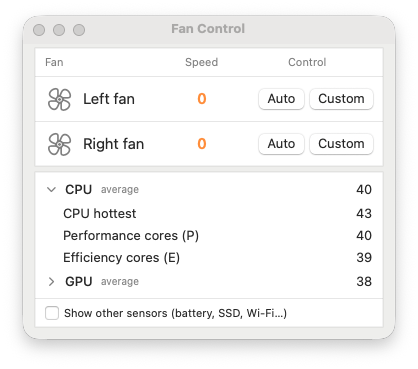
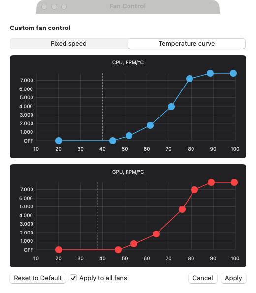

# Fan Control

A small fan monitor and controller for Apple Silicon Macs. Native SwiftUI app, no third-party dependencies, no kernel
extension.

| Main window | Curve editor |
| --- | --- |
|  |  |

## Features

- Live fan speed and CPU/GPU temperatures.
- **Medium** / **Turbo**: one click runs every fan at 50% / 100%; click again to go back to what you had.
- **Fixed speed**: type an RPM for each fan.
- **Temperature curve**: draw RPM/°C curves for CPU and GPU; the fan follows whichever asks for more.
- A point at **OFF** stops the fan completely.
- One click to switch a fan between **Auto** and its last custom mode.
- Remembers your settings and reapplies them the next time the app opens.
- Menu bar item that appears only while a fan is under custom control.
- `fanctl`, a command-line tool for the same controls.

## Requirements

- An Apple Silicon Mac with fans. Developed and tested on a MacBook Pro M4 Pro (Mac16,8) running macOS 27; other
  models are untested and may expose different SMC keys.
- macOS 13 or later.
- Xcode (or the Swift 5.9+ toolchain) to build.
- An administrator password, once, to install the helper.

## Install

```sh
git clone <this repository>
cd fancontrol
scripts/build.sh
open -a "Fan Control"
```

`scripts/build.sh` builds a release, packages `Fan Control.app`, and installs it into `/Applications` (quitting the
running copy if there is one).

The first launch is read-only. Click **Install Helper…** at the bottom of the window and enter an administrator password
to enable fan control.

## Using it

Each fan has two buttons:

- **Auto** hands the fan back to macOS.
- **Custom** switches the fan to its last custom mode. Click it again while it is active to open the editor.

The **Medium** and **Turbo** buttons above them run every fan at 50% or 100% of its maximum speed straight away. Click
the lit one again to return each fan to the mode it had before; picking Auto or Custom on a fan also ends it. Neither
is remembered across quits.

The editor has two tabs:

- **Fixed speed**: one field per fan. The value must be above 0 and no higher than the fan's maximum, which is shown
  next to the field. Tick **Return to Auto after … minutes** to run it for a set time; each fan shows the time left,
  then every fan goes back to Auto. Picking a mode by hand cancels the timer.
- **Temperature curve**: two charts, CPU and GPU, driven by the average temperature of each.
  - Drag a point to move it.
  - Double-click empty space to add a point; double-click a point to remove it.
  - Drag a point down to the axis for OFF.
  - The dashed vertical line is the current temperature.
  - **Apply to all fans** (on by default) uses one shared curve for every fan. Untick it to tune a fan on its own.

Quitting the app returns every fan to automatic. Your choice for each fan is saved, so opening the app again restores
it. After a restart the fans stay on automatic until the app is opened.

While any fan is under custom control, closing the window keeps the app running in the menu bar. If every fan is on
auto, closing the window quits the app.

## Command line

`fanctl` ships inside the app bundle:

```sh
F="/Applications/Fan Control.app/Contents/Resources/fanctl"
"$F" status                          # fans, sensors, current modes
"$F" set all 4000                    # both fans at 4000 RPM
"$F" set all medium                  # both fans at 50%
"$F" set all max                     # both fans at 100%
"$F" set 0 sensor cpu.avg 50 85      # fan 0 ramps linearly with average CPU temperature
"$F" set all auto
"$F" sensors --all                   # every SMC temperature key
"$F" read F0Ac F0Tg F0Md             # raw SMC keys
```

A mode set with `fanctl` is held by the helper until it is changed or the machine restarts.

## How it works

| Component | Role |
| --- | --- |
| `Sources/SMCKit` | SMC read/write through IOKit, the sensor catalog, the helper protocol |
| `Sources/fancontrold` | Root helper (LaunchDaemon); the only process that writes to the SMC |
| `Sources/FanControl` | SwiftUI app: main window and menu bar item |
| `Sources/fanctl` | Command-line tool |

Reading the SMC needs no privileges, but writing fan speeds needs root. The app therefore talks to a small root helper
over the Unix socket `/var/run/fancontrol.sock`:

- The helper is installed as `/Library/PrivilegedHelperTools/local.fancontrol.helper` with a LaunchDaemon of the same
  label, and starts at boot.
- It only serves root and the user who installed it, and never sets a speed above the fan's maximum.
- It holds the mode for each fan and reapplies it if the SMC resets (for example after sleep).
- It returns every fan to automatic when it is stopped.

On recent Apple Silicon the system owns the fans, so the helper sets the SMC key `Ftst` before forcing a fan
(`F<n>Md = 1`, target in `F<n>Tg`) and clears it again when no fan is forced.

## Things to know

- **Use at your own risk.** Running fans slower than the system wants makes the machine hotter and can cause thermal
  throttling. Do not leave a fan OFF up to a high temperature.
- Do not run it alongside Macs Fan Control or another fan controller: the two will overwrite each other.
- The buttons switch at once, but the fan itself can lag a few seconds: taking control of a stopped fan takes about
  6 seconds, because the system needs that long to release it.
- While one fan is under custom control, a fan set to Auto idles at its minimum speed instead of stopping. If the
  system refuses to release a single fan, the helper briefly hands all fans back and then retakes the custom ones.
- The "minimum" RPM the machine advertises (2317 on M4 Pro) is not a hard limit: the fan runs down to about 1000 RPM,
  and any lower non-zero value holds at about 970 RPM.
- Apple does not document SMC keys. Sensor names are grouped by key prefix, and no key maps to a single core, so the
  CPU and GPU groups show summary figures (average, hottest, per core cluster) rather than per-core values.
- The app is ad-hoc signed and built locally; it is not notarized.

## Development

```sh
swift build                 # debug build of all targets
scripts/build.sh            # release build, packaged and installed into /Applications
sudo scripts/install-helper.sh   # reinstall the helper after changing its code
scripts/make-icon.sh        # regenerate Resources/AppIcon.icns after editing scripts/make-icon.swift
```

The helper logs to `/var/log/fancontrold.log`. When the helper protocol changes, bump
`HelperSocket.protocolVersion`; the app then offers **Update Helper…**.

## Uninstall

```sh
sudo scripts/uninstall-helper.sh
rm -rf "/Applications/Fan Control.app"
defaults delete local.fancontrol.app
```
